<!-- 道 THE WAY OF THE BUILDER — the profile of Ahmed Zaki Gabr. Every panel is generated SVG (tools/); the duel runs on GitHub Actions (game/). -->

  
  
  

  
  
  
  
  

<a href="#duel"><b>⚔ 決闘 · A boss fight lives on this page. Strike the yokai ↓</b></a>

  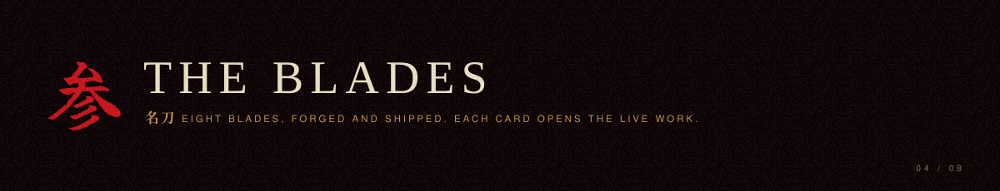
  <a href="https://ahmedzaki.vercel.app">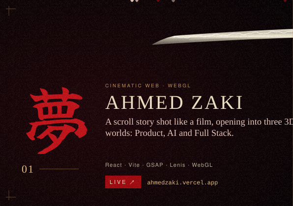</a>
  <a href="https://raphael-studios.vercel.app">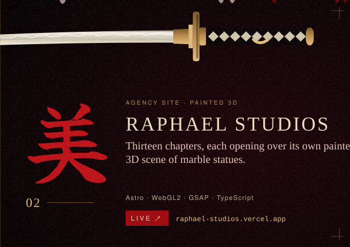</a>
  <a href="https://hitu-1.vercel.app"></a>
  <a href="https://pathway-builder-kappa.vercel.app"></a>
  <a href="https://wfhworkflow.vercel.app">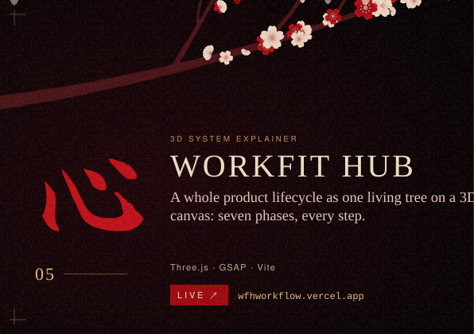</a>
  <a href="https://deebbim.vercel.app">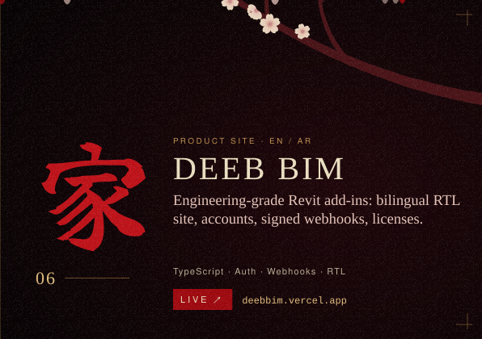</a>
  <a href="https://github.com/Meti-AVP/Meti-AVP/blob/main/projects/green-vision.md">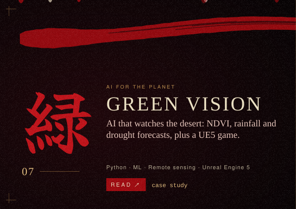</a>
  <a href="https://meti-avp.github.io/v-classification-system/">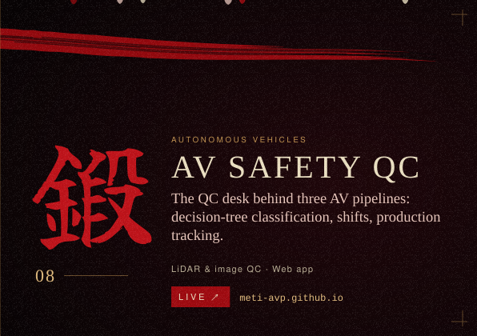</a>

  
  

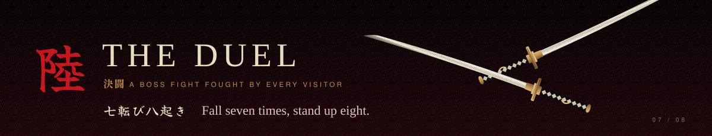

<!-- DUEL:START -->

  
  

  
  
  
  <a href="https://github.com/Meti-AVP/Meti-AVP/issues/new?title=duel%7Ctea&body=Press+%2A%2ASubmit+new+issue%2A%2A+to+strike+with+%E8%8C%B6+%2A%2AFOCUS%2A%2A.%0A%0AThe+dojo+resolves+your+move+in+about+a+minute+and+the+profile+updates.+No+need+to+write+anything.+%E4%B8%83%E8%BB%A2%E3%81%B3%E5%85%AB%E8%B5%B7%E3%81%8D.">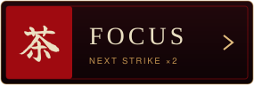</a>

<b>誤札鬼 · Mislabel Oni</b>: <i>Feeds on every mislabeled LiDAR frame.</i> 
Pick a move ➜ GitHub opens an issue ➜ press <b>Submit new issue</b>. The dojo resolves it in about a minute and this screen updates. Every visitor fights the same yokai.

<table align="center"><tr><td valign="top">

**Last moves**

<table><tr><th>Turn</th><th>Fighter</th><th>Move</th><th>Result</th></tr>
<tr><td>1</td><td><a href="https://github.com/Meti-AVP">@Meti-AVP</a></td><td>斬 Slash</td><td>13 dmg</td></tr>
</table>

</td><td valign="top">

**殿堂 · Hall of honor**

<table><tr><th></th><th>Fighter</th><th>Damage</th><th>Slain</th></tr>
<tr><td>一</td><td> <a href="https://github.com/Meti-AVP">@Meti-AVP</a></td><td>13</td><td>0</td></tr>
</table>

</td></tr></table>

<!-- DUEL:END -->

  

道 · Every panel above is generated SVG, art and all: <a href="https://github.com/Meti-AVP/Meti-AVP/tree/main/tools">tools/</a>. The duel is played in issues and resolved by GitHub Actions: <a href="https://github.com/Meti-AVP/Meti-AVP/tree/main/game">game/</a>.

