<!-- 道 THE WAY OF THE BUILDER — the profile of Ahmed Zaki Gabr. Every panel is generated SVG (tools/); the duel runs on GitHub Actions (game/). -->

  
  
  

  
  
  
  
  

<a href="https://meti-avp.github.io/Meti-AVP/play/"><b>⚔ 居合 · Play the samurai quick-draw instantly ↗</b></a> &nbsp;·&nbsp; <a href="#duel"><b>決闘 · Or strike the community yokai ↓</b></a>

  
  <a href="https://syra-one-app.vercel.app"></a>
  <a href="https://meti-avp.vercel.app">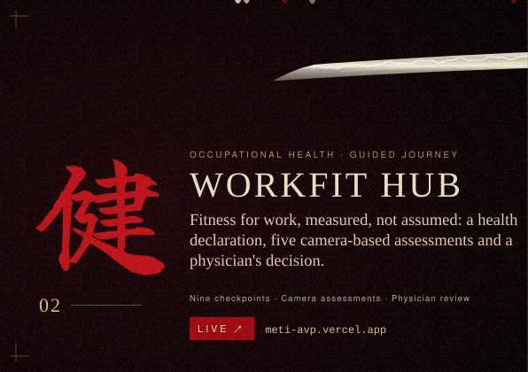</a>
  <a href="https://raphael-studios-v5.vercel.app">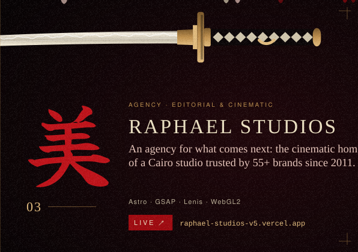</a>
  <a href="https://syra-lms-tau.vercel.app"></a>
  <a href="https://syra-local.vercel.app"></a>
  <a href="https://syra-situ-videos.vercel.app/browse">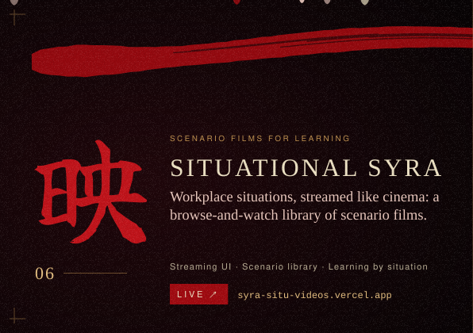</a>
  <a href="https://syra-pitch.vercel.app">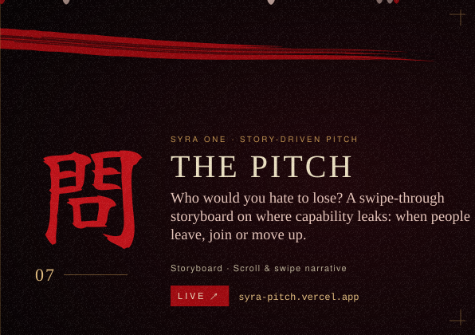</a>

  
  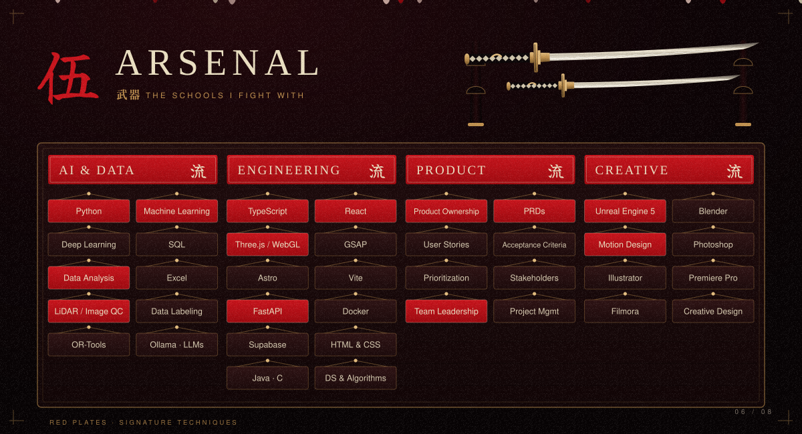

  
  

<!-- DUEL:START -->

  
  

  <a href="https://github.com/Meti-AVP/Meti-AVP/issues/new?title=duel%7Cslash&body=%23%23+%F0%9F%91%87+Press+the+green+%2A%2ACreate%2A%2A+button+below+to+strike+with+%E6%96%AC+SLASH%0A%0AThat%27s+all%3A+no+need+to+write+anything+or+change+the+title.+The+dojo+bot+resolves+your+move+within+a+minute%2C+replies+here%2C+and+the+duel+on+the+profile+updates.+%E4%B8%83%E8%BB%A2%E3%81%B3%E5%85%AB%E8%B5%B7%E3%81%8D">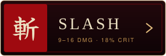</a>
  <a href="https://github.com/Meti-AVP/Meti-AVP/issues/new?title=duel%7Carrow&body=%23%23+%F0%9F%91%87+Press+the+green+%2A%2ACreate%2A%2A+button+below+to+strike+with+%E5%BC%93+ARROW%0A%0AThat%27s+all%3A+no+need+to+write+anything+or+change+the+title.+The+dojo+bot+resolves+your+move+within+a+minute%2C+replies+here%2C+and+the+duel+on+the+profile+updates.+%E4%B8%83%E8%BB%A2%E3%81%B3%E5%85%AB%E8%B5%B7%E3%81%8D">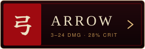</a>
  <a href="https://github.com/Meti-AVP/Meti-AVP/issues/new?title=duel%7Cbloom&body=%23%23+%F0%9F%91%87+Press+the+green+%2A%2ACreate%2A%2A+button+below+to+strike+with+%E6%A1%9C+BLOOM%0A%0AThat%27s+all%3A+no+need+to+write+anything+or+change+the+title.+The+dojo+bot+resolves+your+move+within+a+minute%2C+replies+here%2C+and+the+duel+on+the+profile+updates.+%E4%B8%83%E8%BB%A2%E3%81%B3%E5%85%AB%E8%B5%B7%E3%81%8D">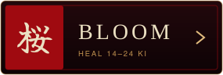</a>
  

<b>誤札鬼 · Mislabel Oni</b>: <i>Feeds on every mislabeled LiDAR frame.</i> 
<b>COMMUNITY DUEL</b> · every visitor fights the same yokai. Pick a move ➜ GitHub opens an issue ➜ press the green <b>Create</b> button. The bot resolves it within a minute and this screen updates.

<table align="center"><tr><td valign="top">

**Last moves**

<table><tr><th>Turn</th><th>Fighter</th><th>Move</th><th>Result</th></tr>
<tr><td>1</td><td><a href="https://github.com/Meti-AVP">@Meti-AVP</a></td><td>斬 Slash</td><td>13 dmg</td></tr>
</table>

</td><td valign="top">

**殿堂 · Hall of honor**

<table><tr><th></th><th>Fighter</th><th>Damage</th><th>Slain</th></tr>
<tr><td>一</td><td> <a href="https://github.com/Meti-AVP">@Meti-AVP</a></td><td>13</td><td>0</td></tr>
</table>

</td></tr></table>

<!-- DUEL:END -->

  

道 · Every panel above is generated SVG, art and all: <a href="https://github.com/Meti-AVP/Meti-AVP/tree/main/tools">tools/</a>. The duel is played in issues and resolved by GitHub Actions: <a href="https://github.com/Meti-AVP/Meti-AVP/tree/main/game">game/</a>.

