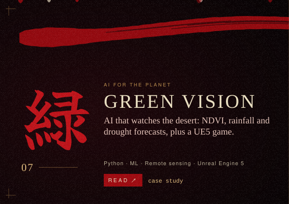

# 緑 Green Vision

**AI and environmental innovation · Founder & lead developer · 2025**

Green Vision watches the desert. It is an AI platform that monitors desertification and soil
health, and forecasts **NDVI**, **rainfall** and **drought** so that land can be protected
before it is lost. It reaches people as well as analysts: an educational website and an
interactive **Unreal Engine 5** game carry the same story to anyone who plays.

## What it does

- **Monitors** desertification and soil health from satellite data.
- **Predicts** NDVI (vegetation health), rainfall and drought ahead of time.
- **Teaches** through an educational site and an interactive UE5 game built around the project's theme.

## Where it was presented

| Stage | Recognition |
|---|---|
| NASA International Space Apps Challenge 2025 | **Galactic Problem Solver**: Green Vision on NASA data, with an interactive game built around it |
| European Union & World Water Week 2025 | Presented to leading investors, the Minister of Water Resources and the EU Ambassador |
| IEEE Zewail City · AppX'25 "Shaping Tomorrow" | Certificate of Appreciation, McCarthies Team: innovation, teamwork, problem-solving |
| Ministry of Youth & Sports | Recognition from Minister Prof. Dr. Ashraf Sobhy and his assistants |

## Stack

Python · machine learning · remote sensing (NDVI) · time-series forecasting · Unreal Engine 5 · web

<a href="../README.md">← back to the profile</a>

